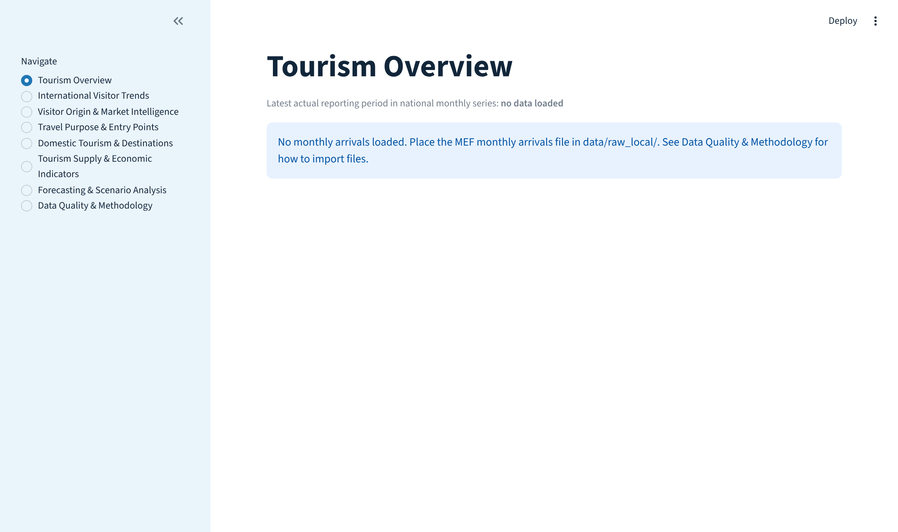

# Cambodia Tourism Intelligence & Demand Analytics

*A reproducible data pipeline, validation framework and analytics dashboard for Cambodia's official tourism statistics.*


> **Project status: in progress.** The software (ingestion, validation, warehouse, analytics,
> forecasting backtests and an 8-page dashboard) is built and tested. **No Cambodian tourism data
> has been analysed yet, and this repository contains no findings or forecasts.** Data will be
> loaded once the licensing terms of the official sources are confirmed (see
> [Data sources and licensing](#data-sources-and-licensing)).

---

## Contents

1. [Overview](#overview)
2. [Research questions](#research-questions)
3. [Data sources and licensing](#data-sources-and-licensing)
4. [System architecture](#system-architecture)
5. [Data quality framework](#data-quality-framework)
6. [Forecasting methodology](#forecasting-methodology)
7. [Dashboard](#dashboard)
8. [Getting started](#getting-started)
9. [Verification](#verification)
10. [Project status and roadmap](#project-status-and-roadmap)
11. [Limitations](#limitations)
12. [Documentation](#documentation)
13. [Author, licence and citation](#author-licence-and-citation)

---

## Overview

Tourism is one of Cambodia's main sources of foreign exchange and employment, and official
statistics on it are published by the Ministry of Tourism and on the Ministry of Economy and
Finance open-data portal (Data EF). These statistics come in several formats (monthly series,
annual breakdowns by entry point, origin and purpose, and PDF reports) with different
definitions and levels of aggregation.

This project builds the infrastructure needed to analyse them **correctly and reproducibly**:

- **Strict ingestion** of manually supplied official files, with SHA-256 checksums and explicit
  column mappings.
- **Validation before analysis**: missing months, duplicate keys, negative values, and
  reconciliation of detailed rows against reported totals.
- **A documented warehouse** (Parquet + DuckDB) that keeps each dimension (time, entry point,
  origin, purpose) in its own table and never sums total rows with detail rows.
- **Statistical forecasting held to a baseline standard**: models are only reported if a
  backtest shows they beat seasonal naive, and only on a long enough, structurally stable period.
- **An interactive dashboard** that states clearly when data are missing rather than showing
  empty or misleading charts.

## Research questions

| # | Question | Required data | Status |
|---|---|---|---|
| RQ1 | How have international arrivals evolved, and how strong is seasonality? | Monthly arrivals | Open |
| RQ2 | Which origin markets drive arrivals, and how concentrated are they? | Origin breakdown | Open |
| RQ3 | Through which entry points, and for which purposes, do visitors arrive? | Entry point and purpose tables | Open |
| RQ4 | How did the market recover after COVID-19, and is the recovery complete? | Monthly arrivals, 2019 onwards | Open |
| RQ5 | What do domestic tourism and supply indicators (rooms, occupancy, receipts) show? | Ministry of Tourism reports (PDF) | Open |
| RQ6 | Can short-term demand be forecast better than a seasonal baseline? | Long, gap-free monthly series | Open |

All questions are open: none has been answered, because no data has been loaded.

## Data sources and licensing

| ID | Source | Content | Access | Licence |
|---|---|---|---|---|
| A | MEF Data EF ([data.mef.gov.kh](https://data.mef.gov.kh)) | Monthly international arrivals | Manual download | Not yet confirmed |
| B, C | MEF Data EF | Arrivals by entry point, 2024 and 2025 | Manual download | Not yet confirmed |
| D | MEF Data EF | Arrivals by origin and purpose, 2024 and 2025 | Manual download | Not yet confirmed |
| E | Ministry of Tourism ([tourism.gov.kh](https://tourism.gov.kh)) | Statistical reports | PDF | Not yet confirmed |

- **No data are stored in this repository.** Files are placed by the user in
  `data/raw_local/<source_id>/`, which is git-ignored, as are all derived files.
- **Access:** the first build ran in a cloud environment whose network policy blocked both
  government sites ([audit](docs/DATA_FEASIBILITY_AUDIT.md)). On 2026-11-06 both sites
  responded normally (HTTP 200) from a local machine; their datasets and terms of use have not
  yet been inspected.
- **Licensing:** public availability is not permission to redistribute. Before any results,
  charts or derived tables are published, the terms of each source will be read and, where
  unclear, permission requested from MEF and the Ministry of Tourism
  ([licence audit](docs/DATA_LICENSE_AUDIT.md)). Nothing in this repository implies
  endorsement by either institution.

## System architecture

```
 Official files (manual)          data/raw_local/<source_id>/   (git-ignored)
          │
          ▼
 ingest.py      checksums, strict parsing, column mapping (config/sources.yaml)
          │
          ▼
 validate.py    missing months · duplicates · negatives · total-vs-detail reconciliation
          │
          ▼
 warehouse.py   standardised Parquet  ──►  DuckDB  (sql/10_analytics.sql, documented grain)
          │
          ├──► analytics.py   growth, seasonality, market shares, concentration
          ├──► forecast.py    baselines, ETS, SARIMA, expanding-window backtests
          ▼
 app/streamlit_app.py         8-page dashboard (bound to 127.0.0.1)
```

| Component | Technology |
|---|---|
| Language | Python 3.11+ |
| Data processing | pandas, PyArrow |
| Warehouse | DuckDB (SQL views over Parquet) |
| Statistics and forecasting | statsmodels |
| Dashboard | Streamlit, Plotly |
| Configuration | YAML source registry |
| Quality assurance | pytest (incl. Streamlit AppTest), Ruff, Bandit, pip-audit |

```
cambodia-tourism-intelligence/
├── app/streamlit_app.py       dashboard
├── config/sources.yaml        source registry and column mappings
├── data/raw_local/            user-supplied official files (git-ignored)
├── docs/                      audits, methodology, data dictionary, results, roadmap
├── sql/10_analytics.sql       analytical tables
├── src/tourism_intel/         dates, ingest, validate, warehouse, analytics, forecast, pipeline
└── tests/                     36 tests on synthetic fixtures
```

## Data quality framework

Official tourism tables often mix national totals, regional subtotals and country rows in one
sheet, and different publications may report different totals for the same period. The pipeline
handles this explicitly:

| Check | Purpose |
|---|---|
| Missing months (`validate.missing_months`) | Detects gaps before any trend or seasonal analysis |
| Duplicate keys | Prevents double counting after repeated imports |
| Negative values | Flags parsing or data-entry errors |
| Total and level tagging (`is_total_row`, `level`) | Keeps totals and regions from being summed with detail rows |
| Reconciliation (`validate.reconcile`) | Entry-point detail vs reported total; entry points vs national monthly series; countries vs regions |
| Complete-year detection | Prevents partial years from being compared with full years |

Every check produces a report shown on the *Data Quality & Methodology* page. See
[docs/DATA_QUALITY_REPORT.md](docs/DATA_QUALITY_REPORT.md) and
[docs/DATA_DICTIONARY.md](docs/DATA_DICTIONARY.md).

## Forecasting methodology

Forecasting is treated as a hypothesis to be tested, not a deliverable:

1. **Regime selection.** The COVID-19 period (2020-03 to 2022-12 by default, configurable) is
   excluded, and models are evaluated on one structurally stable regime at a time.
2. **Feasibility gate.** `forecast.assess_feasibility` requires at least 48 gap-free months in
   the regime. If the post-COVID series is shorter (likely, given the expected coverage), no
   model is fitted.
3. **Baselines first.** Naive and seasonal naive (lag 12) are always computed.
4. **Candidate models**, with fixed specifications (no search on the test period): exponential
   smoothing with additive damped trend and additive seasonality, and SARIMA(1,1,1)(0,1,1)<sub>12</sub>.
5. **Evaluation.** Expanding-window backtests, scored by MAE, RMSE and sMAPE, and reported
   relative to seasonal naive.
6. **No forward forecasts by design** unless a model shows a clear and stable advantage over the
   seasonal baseline.

Details: [docs/METHODOLOGY.md](docs/METHODOLOGY.md).

## Dashboard

| Page | Content | State without data |
|---|---|---|
| Tourism Overview | Headline indicators, latest reporting period | Empty-state guidance |
| International Visitor Trends | Monthly series, growth, seasonality | Empty-state guidance |
| Visitor Origin & Market Intelligence | Market shares, concentration | Empty-state guidance |
| Travel Purpose & Entry Points | Purpose mix, land/air/sea entry | Empty-state guidance |
| Domestic Tourism & Destinations | Domestic indicators | Explanatory placeholder (PDF extraction not built) |
| Tourism Supply & Economic Indicators | Rooms, occupancy, receipts | Explanatory placeholder (PDF extraction not built) |
| Forecasting & Scenario Analysis | Backtest results, feasibility verdict | Empty-state guidance |
| Data Quality & Methodology | Validation reports, import instructions | Lists every source as missing |



*The dashboard as it appears before any data is imported: it reports what is missing instead of
drawing empty charts.*

## Getting started

```bash
git clone https://github.com/THYCHANTHA/cambodia-tourism-intelligence.git
cd cambodia-tourism-intelligence
python -m venv .venv
source .venv/bin/activate            # Windows: .venv\Scripts\activate
pip install -e ".[dev]"

# 1. Place downloaded official files in data/raw_local/<source_id>/ (see config/sources.yaml)
# 2. Build the warehouse
python -m tourism_intel.pipeline
# 3. Launch the dashboard (http://127.0.0.1:8501)
streamlit run app/streamlit_app.py
# 4. Run the checks
pytest
ruff check .
```

Without data files the pipeline completes and reports every source as missing, and the dashboard
shows its empty states.

## Verification

All tests use synthetic fixtures; none use real data.

| Check | Environment | Result |
|---|---|---|
| `pytest` (36 tests, incl. Streamlit AppTest on all 8 pages) | Cloud, Linux, 2026-11-05 | 36 passed |
| `pytest` | Local, Windows 11, Python 3.12.5, pandas 3.1, DuckDB 2.0, Streamlit 1.66, 2026-11-06 | 36 passed |
| `ruff check .` | Both environments | No issues |
| `bandit -r src app` | Cloud, 2026-11-05 | No issues after fixes (two table-name warnings handled) |
| `pip-audit -r requirements.txt` | Cloud, 2026-11-05 | No known vulnerabilities |
| Pipeline with no data | Cloud, 2026-11-05 | Completes; every source reported missing |
| Dashboard health endpoint | Cloud, 2026-11-05 | HTTP 200 |

Continuous integration is not configured.

## Project status and roadmap

| Area | Status |
|---|---|
| Pipeline, validation, warehouse, analytics, forecasting code | Done; tested on synthetic data |
| Dashboard (8 pages) | Done; shows empty states |
| Source access | Sites reachable locally (2026-11-06); datasets not yet inspected |
| Data licensing | Unresolved for all sources |
| Column mappings in `config/sources.yaml` | Placeholders; must be checked against the real files |
| PDF extraction (Ministry reports) | Not built |
| Research findings and forecasts | None yet |

Next steps, in order ([docs/NEXT_STEPS.md](docs/NEXT_STEPS.md)):

1. Read the terms of use of each source; request permission where unclear.
2. Download the files, inspect coverage and definitions, and correct the column mappings.
3. Run the pipeline and validation; record data quality findings.
4. Answer RQ1 to RQ4 and run the forecasting feasibility gate and backtests.
5. Build verified PDF table extraction for RQ5.
6. Publish results only within what the data licences allow.

## Limitations

- **No real data analysed**: every statement about Cambodian tourism in this repository is a
  question, not a finding.
- Column mappings are educated placeholders until the real files are inspected.
- Forecasting is likely to be limited by the short post-COVID series.
- Domestic tourism and supply pages depend on PDF extraction that is not yet built.
- Licensing of all sources is unresolved; results may not be publishable even after analysis.

## Documentation

| Document | Content |
|---|---|
| [DATA_FEASIBILITY_AUDIT.md](docs/DATA_FEASIBILITY_AUDIT.md) | Source access attempts and what can and cannot yet be answered |
| [DATA_LICENSE_AUDIT.md](docs/DATA_LICENSE_AUDIT.md) | Licensing status and open questions |
| [DATA_PROVENANCE.md](docs/DATA_PROVENANCE.md) | How files enter the pipeline and are tracked |
| [DATA_DICTIONARY.md](docs/DATA_DICTIONARY.md) | Tables, columns and grain |
| [DATA_QUALITY_REPORT.md](docs/DATA_QUALITY_REPORT.md) | Validation rules and report format |
| [METHODOLOGY.md](docs/METHODOLOGY.md) | Analytical and forecasting methods |
| [RESULTS.md](docs/RESULTS.md) | Results (none yet) |
| [NEXT_STEPS.md](docs/NEXT_STEPS.md) | Roadmap |
| [BUILD_STATUS.md](BUILD_STATUS.md) | Build log |

## Author, licence and citation

**Author:** Thy Chantha ([GitHub](https://github.com/THYCHANTHA)). Part of a data science
portfolio on Cambodian public data; developed with AI assistance (Claude), with all results
subject to the verification rules above.

**Software licence:** not yet chosen; until a licence is added, all rights are reserved by the
author. Data licences are separate from the software licence and belong to the publishing
institutions.

**Data acknowledgement:** Ministry of Economy and Finance (Data EF portal) and Ministry of
Tourism, Kingdom of Cambodia. This project is independent and not endorsed by either.
